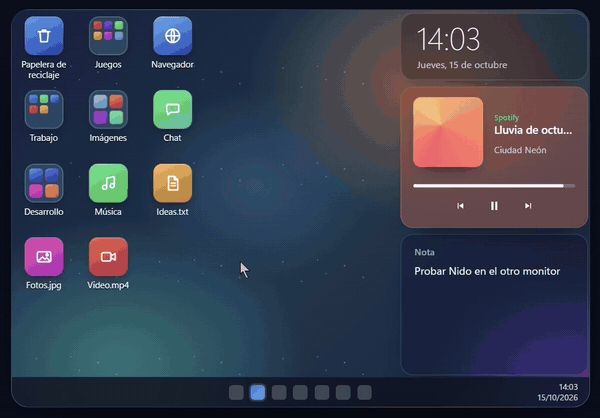

# 🪺 Nido

**Un escritorio nuevo para Windows 10 y 11.**
Carpetas que se expanden en el lugar, widgets sobre vidrio y una caja de selección que da gusto usar.

  

**[🌐 nido.serfley.com](https://nido.serfley.com)**

[Probar la demo interactiva](https://nido.serfley.com/#desk) · [Reportar un fallo](https://github.com/JOFLEY/nido-releases/issues/new?template=bug_report.yml) · [Sugerir una mejora](https://github.com/JOFLEY/nido-releases/issues/new?template=feature_request.yml)

---

## ✨ Qué tiene

| | |
|---|---|
| 📁 **Carpetas que se expanden** | Arrastra un ícono sobre otro y se crea una carpeta con nombre propio ("Juegos", "Documentos"…). Se abre en el lugar, con un clic. Tus archivos no se mueven: las carpetas son virtuales. |
| 🧠 **Se organiza solo** | *Organizar escritorio* propone carpetas por tipo y por marca, sin internet. Carpetas inteligentes de *Frecuentes* y *Recientes*. Todo se deshace con un clic. |
| 🎵 **Widget de Spotify** | Portada, controles, aleatorio, repetir y una barra que se toca o se arrastra. El fondo toma el color de la portada. No pide tu cuenta. |
| 📊 **Estado del equipo** | Anillos de CPU, RAM, GPU y disco, y la velocidad de la red con su gráfica. Eliges qué mostrar. Deja de medir cuando no se ve. |
| 🔲 **Selección fluida** | La caja de selección dibuja un hilo de luz hacia cada ícono y va fluida aunque elijas cientos de archivos. |
| 🔍 **Buscador** | Win+Alt+Espacio busca en el escritorio, en tus carpetas y en todas las apps instaladas. |
| 🖥️ **Varios monitores** | Cada monitor con su propio escritorio y su propia escala. Si desconectas uno, sus íconos esperan y vuelven solos. |
| 🎨 **Personalización** | Tamaño de íconos, intensidad del vidrio, color por carpeta, perfiles ("Trabajo", "Gaming") y tema claro u oscuro. |

Y lo de siempre sigue funcionando: el menú de clic derecho de Windows con tus extensiones, arrastrar a otras apps, la Papelera, Win+D, Ctrl+C / Ctrl+V, F2 y Supr.

## 🎮 Próximamente: Nido Sala

Estoy preparando una biblioteca para recorrer juegos, aplicaciones y archivos con un mando, además de búsqueda y teclado en pantalla. Es una funcionalidad aparte y **todavía no está incluida en la descarga pública 0.3.0**.

## 🧪 Ayuda a probar Nido

Busco personas que lo usen en distintos equipos con Windows 10 u 11. Si algo falla o resulta confuso, [abre un reporte](https://github.com/JOFLEY/nido-releases/issues/new?template=bug_report.yml) con los pasos para reproducirlo, la versión de Nido y tu versión de Windows. También puedes [proponer una mejora](https://github.com/JOFLEY/nido-releases/issues/new?template=feature_request.yml).

Si te sirve y quieres encontrar el proyecto después, puedes darle una estrella en GitHub. Los comentarios de quienes lo prueban ayudan a decidir qué mejorar primero.

## ⬇️ Instalar

1. Descarga **[Nido-win-Setup.exe](https://github.com/JOFLEY/nido-releases/releases/latest/download/Nido-win-Setup.exe)** (siempre la última versión).
2. Ábrelo. Se instala para tu usuario, sin pedir permisos de administrador, y Nido se abre solo.

> [!NOTE]
> Windows puede mostrar "Windows protegió su PC" porque el instalador no está firmado: toca **Más información → Ejecutar de todas formas**.

Descarga Nido solo desde este repositorio o desde [nido.serfley.com](https://nido.serfley.com/). El repositorio público contiene los instaladores y la información de las versiones; el código fuente aún no es público.

## 🔄 Actualizaciones

Nido busca versiones nuevas al iniciar y cada 6 horas. Cuando hay una, avisa en la bandeja del sistema: un clic y se actualiza solo. También puedes buscar a mano desde el ícono de la bandeja → *Buscar actualizaciones*. Los cambios de cada versión están en [Releases](https://github.com/JOFLEY/nido-releases/releases).

## 🗑️ Desinstalar

Configuración de Windows → Aplicaciones → Nido → Desinstalar. El escritorio de Windows vuelve a como estaba.

---

Este repositorio solo contiene los instaladores. Hecho con C#, .NET 9 y WPF por <a href="https://github.com/JOFLEY">JOFLEY</a> 🇵🇾
